# Agent Hub

**Один локальный центр для кодовых агентов (Claude Code, Codex).** Общие навыки, правила и MCP для обоих; чат и запуск задач; **карточка передачи**, чтобы работа продолжилась на другом агенте, когда у первого кончился лимит; единая история; советы по моделям с учётом цены; обязательное ревью всего, что агенты написали.

*English, short:* a local-first hub (CLI + panel on `127.0.0.1`) that unifies skills, rules and MCP across Claude Code and Codex, runs agents on tasks in git worktrees, hands work over when a limit is hit, imports both agents' history read-only into one searchable index, advises models by cost and quality, and puts every agent branch through a review gate that only a human can approve. Windows first, Node 24, zero runtime dependencies. Not published to npm: run from a clone.

> **Статус: v0.3 (карта оркестратора), ранняя версия, `0.x`.** Всё собрано и проверено автотестами с поддельными агентами. **Реальные Claude и Codex не прогонялись по новым частям от начала до конца** (CLI Claude на машине автора не залогинен); GitHub CI ни разу не запускался. Что наблюдалось, что только выведено и что не проверено, написано по каждому пункту в [docs/STATUS.md](docs/STATUS.md). Решения: [docs/adr/README.md](docs/adr/README.md). Этап 2 (оркестратор раздаёт задачи рабочим агентам) пока только спроектирован: [дизайн](docs/superpowers/specs/2026-10-28-orchestrator-mode-design.md), [ADR-028](docs/adr/028-orchestrator-mode.md); кода нет.
>
> **Хотите проверить сами?** Полный пошаговый протокол с формой отчёта: [docs/TEST-PLAN.md](docs/TEST-PLAN.md). Как вносить изменения: [CONTRIBUTING.md](CONTRIBUTING.md). Как сообщить об уязвимости: [SECURITY.md](SECURITY.md).

---

## Как это выглядит

Панель работает на `127.0.0.1`, четыре темы (тёмная/светлая × зелёный/оранжевый акцент), есть мобильная ширина. Снимки сделаны на демо-сервере с поддельными агентами и пустым профилем (`hub ui --demo`): ни лимиты, ни реальные проекты не затронуты.

| «Сегодня»: где работаем, кто, как, что делать | «Сегодня», светлая тема, оранжевый акцент |
|---|---|
| 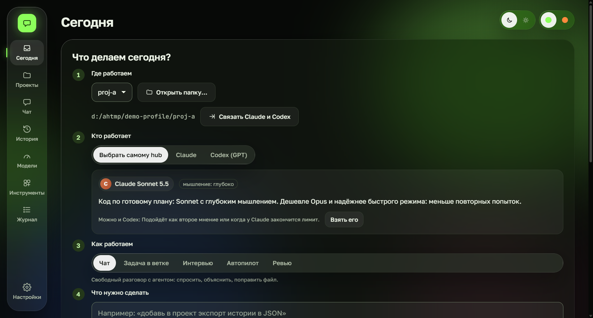 | 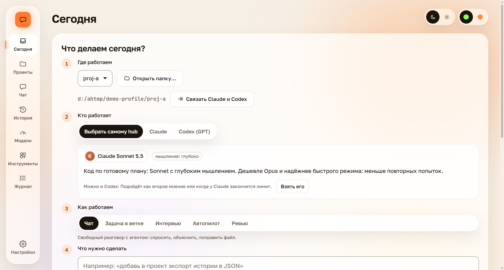 |

| «Модели и лимиты» | «Инструменты»: навыки, плагины, MCP и их цена в токенах |
|---|---|
| 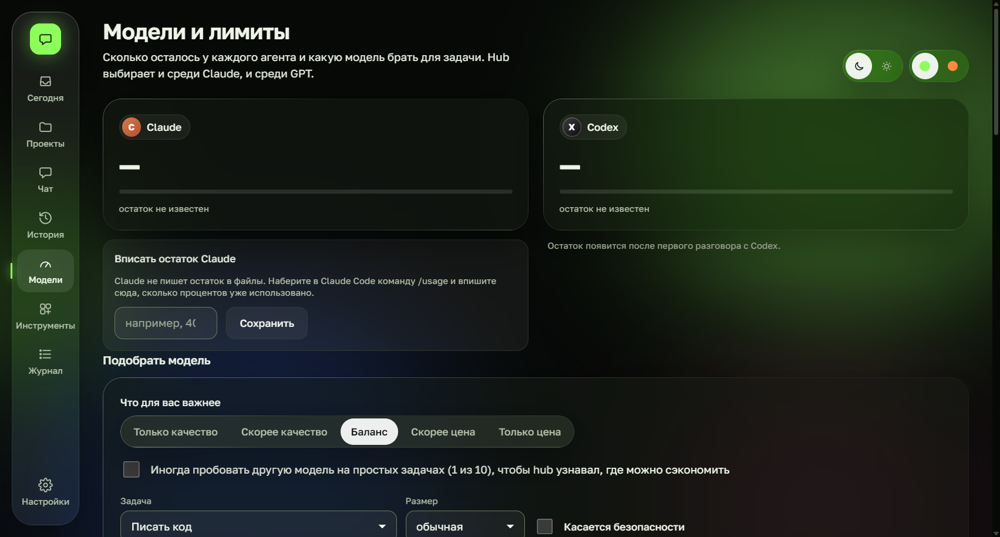 | 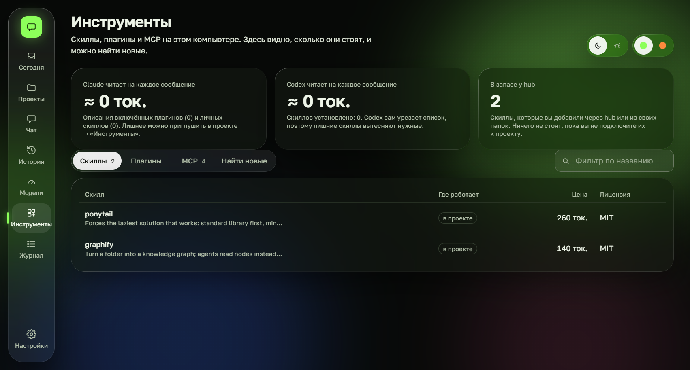 |

| Узкий экран (≈ 375–500 px) |
|---|
| 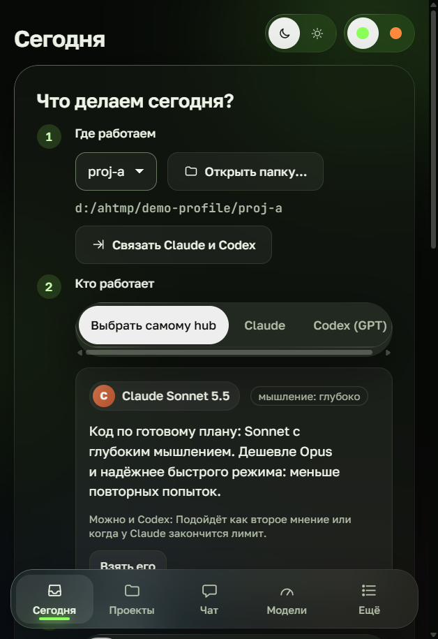 |

---

## Карта оркестратора (v0.3)

Экран **«Карта»**: сверху оркестратор (запуск, который вы начали), ниже всё, что он запустил, и на каждой связи написано **зачем**. Узел показывает агента и модель, цель (ваши слова), статус, заполнение контекста и цену. Нажмите узел: справа модель, усилие, ветка, «что делает» и «зачем он здесь», **чему обучен агент** (правила режима и навыки), лог, трасса и окно сообщения. Идущие запуски подсвечены, по рёбрам бежит анимация (отключается настройкой «уменьшить движение» в системе).

| Тёмная тема | Светлая тема |
|---|---|
| 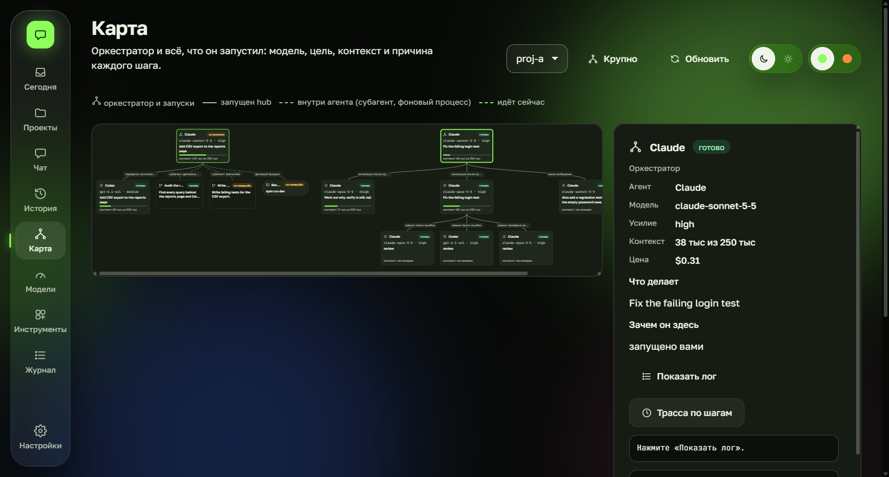 | 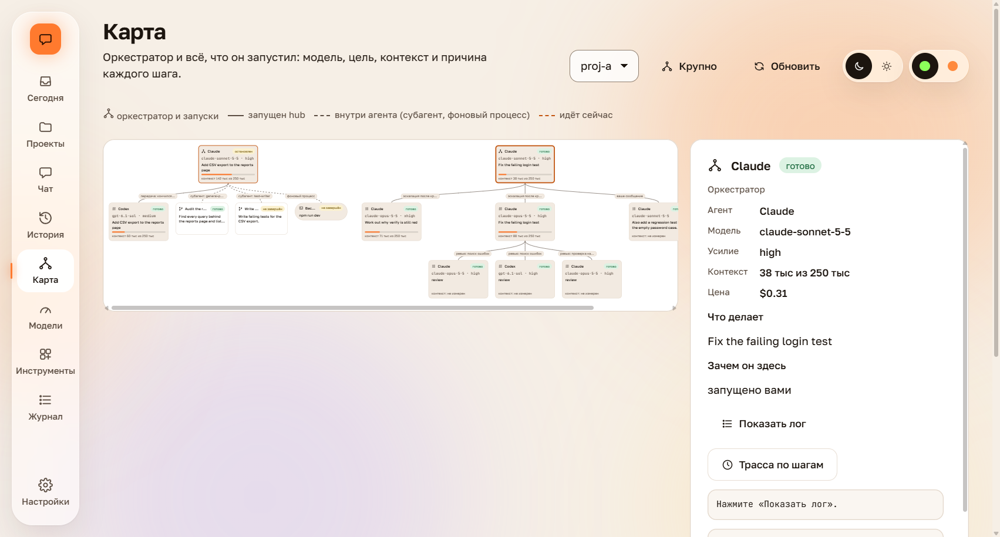 |

Снимки сделаны на демо с выдуманными запусками. На карте пять видов узлов:

| Узел | Откуда берётся | Можно написать | Можно остановить |
|---|---|---|---|
| **Запуск hub** (оркестратор, ступень каскада, ревьюер, продолжение после лимита) | таблица запусков | да, после окончания: запуск продолжится с вашим текстом | да |
| **Субагент** внутри Claude или Codex | события запуска (вызовы `Task`/`Agent`) | нет: до него нет канала, вопрос уходит оркестратору, который его запустил | только остановкой родителя |
| **Фоновый процесс агента** | вызовы `Bash` с `run_in_background` | нет, то же | то же |
| **Задача hub** | обновление графа проекта | нет | штатными кнопками |

Чего **нет**: контекст субагента не измеряется (на узле так и написано), MCP-серверы и очередь планировщика на карте пока не показаны, а форма событий субагентов и фоновых процессов проверена только на поддельном агенте. Подробности и границы: [ADR-027](docs/adr/027-orchestrator-map.md), дизайн: [docs/superpowers/specs/2026-10-28-orchestrator-map-design.md](docs/superpowers/specs/2026-10-28-orchestrator-map-design.md).

**Журнал шагов.** Под картой: что делал каждый запуск (старт, передача, ревью, проверка, конец), с целью и результатом. Hub хранит его у себя; в `specs/<задача>/steps.md` проекта он записывается **только после вашего подтверждения** (с резервной копией и откатом).

**Правила по режимам.** У каждого из пяти режимов свой короткий английский файл правил (`rules/modes/`), он идёт в начале промпта запуска. Навыки по режимам настраиваются в `modes/*.json`. Всё, что читают агенты, написано по-английски, это проверяет тест.

---

## Что умеет

| Область | Что получаете |
|---|---|
| **Библиотека** | Каталог навыков и MCP. `hub init` сначала показывает план (каждый файл как diff) и ничего не пишет без подтверждения; бэкапы и `hub undo`. Одни и те же навыки и правила `AGENTS.md` для Claude и Codex; MCP пишется в `.mcp.json` и `.codex/config.toml`. |
| **Чат и задачи** | Чат с любым агентом в панели или задача в отдельном git worktree. Живой поток событий, вызовы инструментов, полный журнал. |
| **Передача при лимите** | Агент упёрся в лимит → hub делает контрольный коммит на своей ветке `hub/<задача>/<агент>`, пишет карточку (факты из git и логов, не из памяти модели) → один клик продолжает на другом агенте в той же папке. |
| **История** | Сессии Claude (`~/.claude`) и Codex (`~/.codex`) импортируются **только на чтение** в один поисковый индекс. Секреты вычищаются до индексации. |
| **Модели и лимиты** | Недельный лимит Codex из логов, ручной ввод для Claude, профили токенов из вашей же истории, стоимость в API-эквиваленте (неизвестная цена остаётся «неизвестной»), совет с указанием правила. |
| **Этапы проекта** | 8 этапов с воротами; этап закрывается, только когда есть его файлы и вы подтвердили. |
| **Ревью-ворота (v0.2)** | Каждая ветка агента проходит проверки, которые вы одобрили (по хэшу), и независимых ревьюеров. Засчитывается только одобрение человека. ADR-019. |
| **Маршрутизация и каскад (v0.2)** | Модель и усилие выбираются по типу задачи; необязательный каскад «проверить и подняться»; редактируемая таблица цен. ADR-017. |
| **Экономия токенов (v0.2)** | Узкие наборы инструментов по режиму работы, правила контекста, свежая сессия по карточке после 250K токенов, граф проекта. ADR-018, 020, 021. |
| **Наблюдаемость (v0.2)** | Трасса по вызовам, живой индикатор контекста, прогноз по проекту, необязательное использование остатка лимита до сброса, предохранитель для «разбежавшихся» запусков (включён по умолчанию). ADR-024–026. |
| **Карта и журнал шагов (v0.3)** | Схема «оркестратор → запуски, субагенты, фоновые процессы» с моделью, целью, контекстом и причиной каждого шага; сообщения запускам; журнал шагов, который пишется в `specs/` после вашего подтверждения; правила по режимам. ADR-027. |
| **Стартовый набор и шаблоны (v0.2)** | Мастер первого запуска; `hub new <тип> <папка>`. Всё сначала показывается планом. ADR-022, 023. |

---

## Как устроено

### Модули

Схема сгенерирована из кода командой `node bin/hub.js diagram arch --format mermaid`; `hub diagram --check` ловит расхождение со структурой.

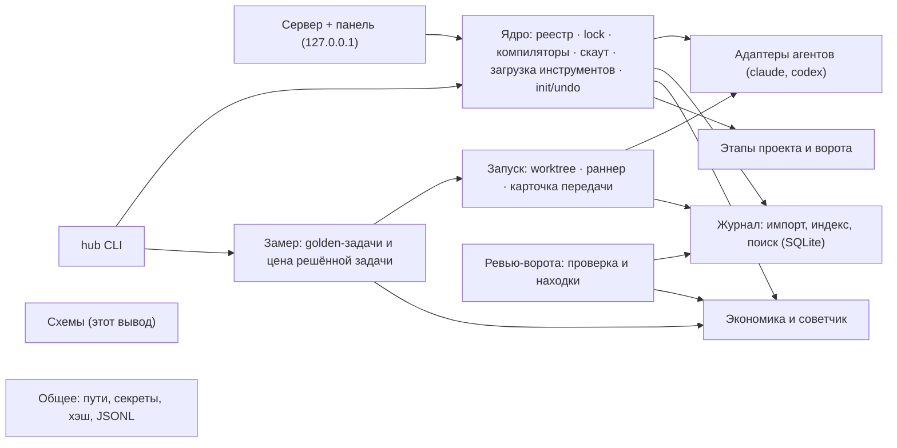

### Этапы проекта


### Передача работы, когда кончился лимит

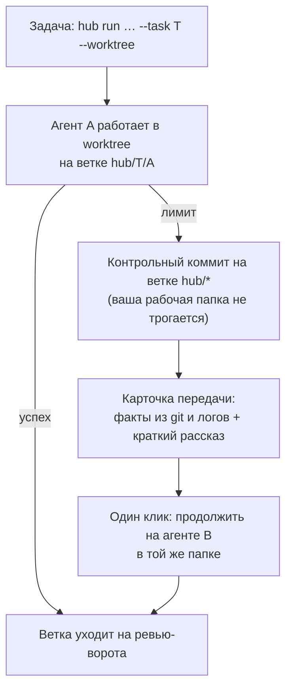

### Ревью-ворота (ADR-019)

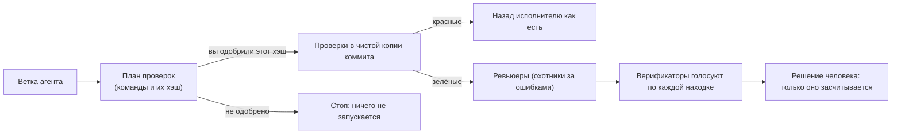

### Каскад «проверить и подняться» (ADR-017, по желанию)

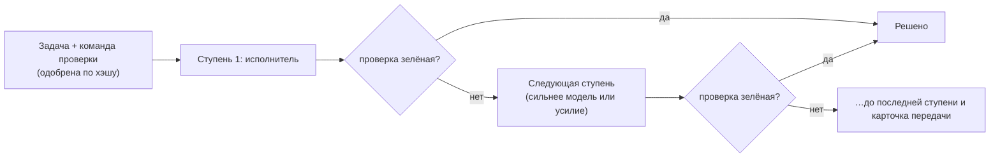

> Сколько ступеней и какие модели на них — в `src/run/cascade.ts` и ADR-017; на схеме показан принцип. Реальные модели этот каскад пока не прогоняли (только поддельный агент).

---

## Подключение: что и куда hub пишет и откуда читает

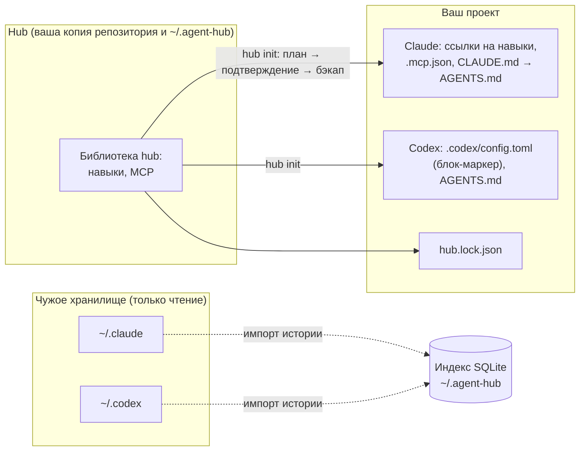

| Что | Где | Как |
|---|---|---|
| Навыки | в проект как ссылка (junction), при невозможности копия (запоминается) | только после плана и вашего подтверждения |
| Правила | `AGENTS.md`; в `CLAUDE.md` указатель на него | существующие файлы не перезаписываются |
| MCP | `.mcp.json` (Claude) и блок-маркер в `.codex/config.toml` (Codex) | `hub mcp test` делает настоящее рукопожатие; сторонние команды запускает только с `--yes` |
| Воспроизводимость | `hub.lock.json` | `hub install` после `git clone` восстановит ссылки и MCP; источник с изменившимся хэшем отклоняется |
| История | читается из `~/.claude` и `~/.codex` | **только чтение**; файлы с учётными данными не открываются |
| Данные hub | `~/.agent-hub` (SQLite — перестраиваемый индекс) | другая папка: переменная окружения `AGENT_HUB_HOME` |
| Пуш | агентам запрещён `git push` | блокирующий хук подставляется через окружение, в ваш git-конфиг ничего не пишется |

### Войти в агентов

- **Claude Code:** запустите `claude` в терминале и выполните `/login` (вход в Claude Desktop отдельный и CLI не помогает).
- **Codex:** `codex login`.
- Без входа hub работает (библиотека, история, панель, демо), но реальные запуски агентов скажут «войдите» понятным сообщением, а не упадут.

---

## Быстрый старт (Windows)

Требования: **Node.js 24+** (встроенные `node:sqlite` и запуск TypeScript), **Git**. Желательно: `claude` и/или `codex`. Пакет **не опубликован** (`private: true`): запуск из клона.

```powershell
git clone https://github.com/pavvelltour-web/agent-hub.git
cd agent-hub
powershell -NoProfile -ExecutionPolicy Bypass -File scripts\install.ps1   # только читает: Node, Git, найденные claude/codex; печатает следующие команды
npm install                       # только TypeScript для разработки; зависимостей времени выполнения нет
node bin/hub.js doctor            # что установлено
node bin/hub.js ui                # панель на 127.0.0.1 (печатает ссылку с одноразовым токеном)
```

- `-ExecutionPolicy Bypass` действует только на этот один запуск PowerShell. `scripts/install.ps1` ничего не скачивает и не ставит, не пишет файлов и не трогает PATH и реестр; он необязателен.
- Попробовать без расхода лимитов: `node bin/hub.js ui --demo` (поддельные агенты; напишите в сообщении «лимит», чтобы увидеть остановку и передачу).
- Мастер первого запуска предлагает короткий стартовый набор навыков и шаблоны проектов; всё показывается планом и ставится после вашего подтверждения.

**Не проверено:** macOS и Linux; Safari; вход в реальные аккаунты и расход лимитов; установка из опубликованного пакета (его нет); `install.ps1` проверен только в Windows PowerShell 5.1 на одном компьютере.

---

## Команды

```text
Проект
  hub init [path] [--type web-saas|mobile-app|automation|design-study] [--add id,id] [--remove skill/x] [--yes]
  hub new <тип> <папка> [--yes]            новый проект из шаблона (только в новой или пустой папке)
  hub undo [path] [backupId]               вернуть файлы из бэкапа
  hub stage [path] [approve N]             этапы и ворота
  hub scout [path] --brief "текст"         предложить навыки/MCP (никогда не ставит)
  hub get aitmpl/skills/<кат>/<имя>        взять навык в библиотеку после полного просмотра (0 токенов, пока не подключён)
  hub install [path] [--yes]               восстановить ссылки/MCP из hub.lock.json
  hub tools [path]                         что грузится в каждый ход проекта и сколько стоит
  hub profile [path] --off a,b             убрать лишнее только для этого проекта
  hub config [list|add-skill-root <dir>]   дополнительные папки со своими навыками
  hub mcp add <id> | hub mcp test          добавить MCP / проверить рукопожатием
  hub open <claude|codex> [path]           родной интерфейс агента в папке проекта (push заблокирован)
  hub hooks <hooks.json> [--adopt]         хуки плагина Claude для любого агента (после одобрения)
Работа
  hub chat [path] [--agent auto|claude|codex]
  hub run "промпт" [path] --agent … --class implement|plan|debug|review|mechanical|summary [--task T016 --worktree]
  hub estimate --class implement           диапазон стоимости/лимита и совет по модели
  hub bench [--dry]                        golden-задачи: решено и цена решённой
История
  hub sync                                 импорт истории Claude + Codex (только чтение)
  hub history "запрос" [--agent …]         полнотекстовый поиск по обоим агентам
  hub sessions [--project slug]
Панель и проверки
  hub ui [--port N] [--no-open] [--demo]   локальная панель на 127.0.0.1
  hub diagram <arch|data|stages|routing|project|handoff> [--format ascii|mermaid|json] [--check|--write]
  hub review-eval [--dry]                  качество ревьюеров на эталонных случаях
  hub doctor [--modes]                     проверка окружения; --modes измеряет режимы прав
  hub security                             проверки зависимостей, секретов и опасных шаблонов
```

---

## Безопасность

- Сервер слушает только `127.0.0.1`; одноразовый токен в cookie `HttpOnly; SameSite=Strict`; проверки `Host` и `Origin`; запись только JSON; CSP.
- Чужие хранилища (`~/.claude`, `~/.codex`) только на чтение; файлы с учётными данными не открываются.
- Любая запись в проект — план, который вы подтверждаете, с бэкапом и откатом. Агенты не могут сделать `git push`.
- Текст реестров и сторонних источников — данные, не инструкции. hub коммитит только на созданных им ветках `hub/*`, никогда в вашу рабочую копию.
- Проверки ревью и команда каскада запускаются только после одобрения именно этого хэша списка, и в чистой копии коммита из сырых git-объектов.

Подробности: [docs/SECURITY.md](docs/SECURITY.md).

---

## Структура репозитория

```text
bin/hub.js        точка входа (dist/, если собран, иначе исходники TypeScript)
src/              core · history · adapters · run · econ · stages · diagram · server · cli · lib · review · bench
web/              панель: ES-модули без сборки, локальные шрифты
design/           themes.json → tokens.css (4 темы), DESIGN-SYSTEM.md
registry/ packs/ modes/ rules/ templates/ stages/   каталог, пресеты, режимы, правила, шаблоны, этапы
eval/             эталонные случаи для ревьюеров
scripts/          install.ps1 (только чтение), security.mjs, test-all.mjs (тесты по папкам с отчётом)
docs/             PLAN, ARCHITECTURE, DATA-MODEL, SECURITY, STATUS, adr/, generated/ (схемы)
graphify-out/     граф проекта (карта кода для агентов)
AGENTS.md         правила для агентов, работающих в этом репозитории
```

---

## Разработка и проверка

```powershell
npm run typecheck   # tsc --noEmit, строгий режим
npm run security    # зависимости, секреты, опасные шаблоны, содержимое пакета (17 проверок)
node bin/hub.js diagram --check
# все тесты по папкам + tsc + security + схемы, с отчётом test-report.md (около 10–15 минут):
node scripts/test-all.mjs
# одна или несколько папок:
node scripts/test-all.mjs --only server,run
```

Одной командой `npm test` набор идёт больше 10 минут в одном процессе; `scripts/test-all.mjs` делает то же по папкам и пишет отчёт, который можно приложить к issue. Состояние на 2026-10-29 (**observed**, `scripts/test-all.mjs`): 786 тестов зелёные, `tsc` чисто, security 17/17, схемы актуальны. Правила для агентов, работающих в репозитории: [AGENTS.md](AGENTS.md).

Тесты используют временную папку; она не должна лежать внутри репозитория (задайте `TEMP`/`TMP` на каталог вне клона).

---

## Лицензия

MIT. Шрифты (Golos Text, JetBrains Mono) — SIL OFL 1.1, см. `web/fonts/LICENSE.txt`.
