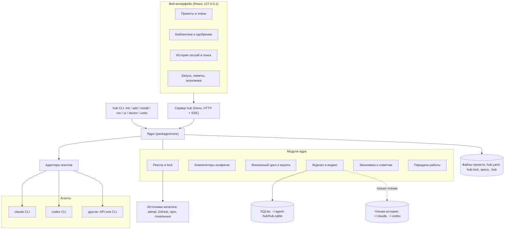

# Agent Hub — архитектура

> Статус: **черновик v0.2 на согласование**, 2026-10-22. Код не пишется, пока вы не одобрите документы.
> Рабочее имя `agent-hub` временное. Документ на русском для вас; перед публикацией на GitHub будет английская версия.
> Связанные файлы: [SCHEMES.md](SCHEMES.md) (схемы), [DATA-MODEL.md](DATA-MODEL.md), [TOOLING.md](TOOLING.md), [MODELS-AND-LIMITS.md](MODELS-AND-LIMITS.md), [SECURITY.md](SECURITY.md).

## 1. Зачем это нужно

Вы работаете над одним проектом то в Claude Code, то в Codex, иногда с другими моделями. Сейчас:

- правила, скиллы, плагины и MCP живут отдельно у каждого агента и дублируются;
- когда у одного агента кончаются лимиты, второй ничего не знает, и вы объясняете всё заново;
- нет общей картины: сколько стоит задача, какую модель взять, сколько осталось лимита.

Agent Hub — локальная панель и CLI, которые:

1. держат **одну библиотеку** скиллов, плагинов, MCP и правил и подключают их к каждому агенту в его родном формате;
2. ведут проект по **фиксированным этапам** (контекст, уточнение, инструменты, архитектура, правила, план) с заранее подобранными скиллами;
3. **запускают любого агента** на задаче в изолированной ветке и передают работу другому агенту, когда у первого кончились лимиты;
4. считают **юнит-экономику**: токены, доллары API-эквивалента, проценты недельного лимита, и советуют модель и уровень рассуждения;
5. показывают **историю сессий** всех агентов в одном месте.

## 2. Цели, не-цели, анти-цели

**Цели**

- Установка в одну команду, без правки чужих конфигов без вашего подтверждения.
- Всё, что можно хранить файлами, хранится файлами в репозитории проекта (Markdown/YAML), чтобы проект можно было клонировать и форкнуть.
- Публикация на GitHub: чужой пользователь ставит ядро, подключает свои агенты и свои наборы.
- Добавление нового агента или нового источника каталога не меняет ядро.

**Не-цели**

- Не объединяем физически хранилища Claude и Codex. Мы их читаем.
- Не делаем общий «мозг» или общий контекст в реальном времени между агентами. Передача идёт через git и карточку передачи.
- Не заменяем сами CLI. Лимиты расходуются через их официальные клиенты.
- Не облачный сервис и не многопользовательская система в версии 1.

**Анти-цели (что считаем провалом, даже если «работает»)**

- Панель молча изменила конфиг агента, хук или правила.
- Секрет (ключ, токен, содержимое `auth.json`) попал в индекс, лог или репозиторий.
- Оптимизация токенов снизила долю успешно решённых задач.
- Для понимания проекта нужна база данных: файлы в репозитории обязаны быть самодостаточными.

## 3. Принципы

1. **Файлы как источник истины, база как индекс.** SQLite можно удалить и пересобрать.
2. **Чужие данные только на чтение.** Папки `~/.claude`, `~/.codex`, `%APPDATA%\Claude` панель не изменяет. Исключение: подключение конфигов агентов, строго по подтверждению и с резервной копией.
3. **Любая запись вне проекта требует подтверждения** и показывает diff до записи.
4. **Всё внешнее — данные, а не инструкции.** Описания и содержимое компонентов каталога не исполняются как команды панели.
5. **Версия и хэш фиксируются** для каждого стороннего компонента (`hub.lock`).
6. **Только localhost.** Сервер слушает `127.0.0.1` и требует токен сессии.
7. **Оценки всегда диапазоном** и с пометкой уверенности. Точных чисел там, где их нет, панель не показывает.
8. **Измеряем, потом оптимизируем.** Каждая оптимизация проходит замер «до и после».

## 4. Компоненты



### 4.1. Ядро (`packages/core`)

| Модуль | Ответственность |
|---|---|
| Реестр | описание компонентов (команда установки, описание, совместимость, лицензия, хэш), поиск, рекомендации под проект |
| Lock | `hub.lock`: выбранные компоненты, версии, хэши, решения по адаптации |
| Компиляторы | из нейтрального описания в родной конфиг агента (скиллы, правила, MCP, субагенты, хуки, разрешения) |
| Жизненный цикл | 8 этапов, результаты-файлы, ворота перехода |
| Журнал | импорт истории агентов, нормализация, FTS-индекс |
| Экономика | оценка токенов, долларов API-эквивалента и процентов недельного лимита, калибровка по факту |
| Советчик | выбор модели и уровня рассуждения по задаче и остатку лимитов |
| Передача | карточка передачи и запуск второго агента |

### 4.2. Адаптеры (`packages/adapter-*`)

Один интерфейс на любого агента:

```ts
interface AgentAdapter {
  id: string;                                   // 'claude' | 'codex' | ...
  detect(): Promise<Detection>;                 // установлен ли CLI, версия, путь
  capabilities(): Capabilities;                 // события хуков, форматы, модели, уровни рассуждения
  start(req: RunRequest): RunHandle;            // cwd, prompt, model, effort, sandbox, env
  events(h: RunHandle): AsyncIterable<HubEvent>;// единый поток событий
  limits(): Promise<LimitStatus | null>;        // null = неизвестно
  stop(h: RunHandle): Promise<void>;
  resume?(h: RunHandle, prompt: string): RunHandle;
  readHistory(): AsyncIterable<NormalizedSession>; // только чтение
}
```

`HubEvent`: `message`, `tool_call`, `tool_result`, `usage`, `limit`, `error`, `done`.

- **Адаптер Claude** запускает CLI в неинтерактивном режиме с потоком событий JSON, читает `~/.claude/projects/**/*.jsonl` и метаданные десктопа.
- **Адаптер Codex** запускает `codex exec` с потоком JSON, читает `~/.codex/sessions/**/rollout-*.jsonl` и `state_5.sqlite` (только чтение). Лимиты берёт из блока `rate_limits` в событиях `token_count`.
- **Универсальный адаптер** для моделей без своего агента-CLI: собственный цикл с инструментами поверх API (версия 2, не в MVP).

Точные флаги CLI проверяются при реализации (см. раздел 12).

### 4.3. Сервер и интерфейс

- Сервер: Hono, HTTP + Server-Sent Events для живых логов. Слушает `127.0.0.1`, токен сессии в заголовке.
- Интерфейс: React + Vite, собранный статикой и отдаваемый сервером. Экраны: проекты и этапы, библиотека и одобрение, история и поиск, запуск, лимиты и экономика, правила (что видит каждый агент).

### 4.4. Структура репозитория

```
agent-hub/
├─ packages/
│  ├─ core/               # реестр, lock, компиляторы, цикл, журнал, экономика
│  ├─ cli/                # команда `hub`
│  ├─ server/             # HTTP + SSE, раннер процессов
│  ├─ web/                # React-интерфейс
│  ├─ adapter-claude/
│  ├─ adapter-codex/
│  └─ schemas/            # JSON Schema для всех файловых форматов
├─ registry/
│  ├─ sources.yaml        # источники: aitmpl, GitHub, npm
│  └─ entries/*.yaml      # записи: команда установки + описание (не копии файлов)
├─ stages/                # шаблоны 8 этапов (YAML + промпты)
├─ packs/                 # пакеты знаний: архитектура, данные, мобильное приложение и т.д.
├─ docs/                  # эти документы, ADR
├─ examples/
└─ pnpm-workspace.yaml
```

Личные данные пользователя (журнал, лимиты, кэш) живут в `~/.agent-hub/` и в репозиторий не попадают.

### 4.5. `hub` как общий CLI для всех нейросетей

Панель не заменяет интерфейс агентов, а даёт **один вход и один конфиг** для любого из них.

| Команда | Что делает |
|---|---|
| `hub init` / `hub undo` | подготовка проекта и откат (показывает план до записи) |
| `hub new <тип> <папка>` | новый проект из шаблона в новой или пустой папке: каркас, правила, скиллы типа, `git init` одним планом; команда `verify` из шаблона не одобрена (ADR-023) |
| `hub config` | просмотр и правка `hub.yaml`: агенты, модели по умолчанию, правила, лимиты передачи |
| `hub add <id>` / `hub remove <id>` | скилл, плагин, хук, правило из каталога, с адаптацией под каждого агента |
| `hub mcp add / list / test / remove` | MCP-серверы (раздел 4.6) |
| `hub scout` | поиск новых скиллов под проект (раздел 4.7) |
| `hub stage <n>` | пройти этап жизненного цикла |
| `hub run --agent <id> --task <T>` | фоновый запуск задачи в worktree с учётом советчика |
| `hub open <agent>` | открыть родной интерактивный интерфейс агента (Claude, Codex) в нужной папке с применённым конфигом |
| `hub estimate` | юнит-экономика плана |
| `hub history` | поиск и просмотр сессий всех агентов |
| `hub diagram` / `hub explain` | схемы и пояснения (см. [SCHEMES.md](SCHEMES.md)) |
| `hub security` | проверки уязвимостей (см. [SECURITY.md](SECURITY.md)) |
| `hub doctor` | диагностика окружения |

Новая нейросеть подключается адаптером: `hub agent add <id>`. Если у неё есть CLI, адаптер запускает его; если только API, используется универсальный адаптер версии 2.

### 4.6. MCP и библиотеки (в том числе для дизайна)

MCP — тип записи реестра (`kind: mcp`). Подключение:

1. `hub mcp add <id>` показывает: что за сервер, команду запуска, нужные переменные окружения, права (сеть, файлы), лицензию.
2. Секреты никогда не пишутся в файлы: в конфиге стоит ссылка на переменную окружения, например `${MOBBIN_TOKEN}`; значение вводите вы в своём окружении.
3. Область действия выбирается явно: `--scope project` (по умолчанию) или `--scope user`.
4. Панель пишет сервер в родные конфиги выбранных агентов (`.mcp.json` для Claude, `[mcp_servers]` в `config.toml` для Codex) и проверяет подключение (`hub mcp test`).
5. Если сервер доступен только одному агенту, статус `unsupported` показывается явно.

Для дизайн-пайплайна нужны MCP-источники референсов и компонентов (по тексту вашего скилла — Mobbin и shadcn). В ваших конфигах их сейчас нет, поэтому они появятся в списке подключений как «нужны для этапа дизайна», без автоустановки.

Сама панель тоже может отдавать **собственный MCP-сервер** (`hub mcp serve`) со статусом этапов, лимитами и карточками передачи, чтобы агент мог их запрашивать. Это опционально, версия 2.

### 4.7. Скаут скиллов («постоянный поиск»)

`hub scout` подбирает компоненты под проект и запускается: на этапе 3, по команде и по расписанию (Планировщик Windows, раз в неделю).

1. Источники: каталог aitmpl, поиск по GitHub через `gh`, локальные папки (`~/.agents`, `~/.codex/skills`), списки, которые вы добавите.
2. Фильтр по `brief.md`, типу проекта и этапу.
3. Оценка каждого кандидата: польза, размер описания в токенах, лицензия, свежесть, число авторов, результат проверки безопасности (SECURITY, раздел 4), совместимость с каждым агентом.
4. Выдача коротким списком с причиной. **Автоматически ничего не устанавливается**: только предложение и diff.
5. Замер: по запросу `hub scout --measure` прогоняет кандидата на тестовой задаче и сравнивает токены и долю успешных с профилем без него.

### 4.8. Политика субагентов

Субагенты по умолчанию **выключены**. Причина измерена на ваших данных: 57% всех токенов Codex ушло в субагентные треды (912 тредов против 106 основных, в среднем 7,3 субагента на основной тред, максимум 175). Каждый субагент начинает с чистого контекста и заново читает файлы.

Включаем, только если выполнены все условия:

1. подзадачи действительно независимы и параллельны;
2. каждой нужен небольшой контекст (порог по умолчанию подберём калибровкой);
3. оценка экономики по `hub estimate` показывает выгоду по времени или качеству, а не просто «параллельно красиво».

Для ревью по diff субагент допустим, потому что контекст ограничен самим diff.

## 5. Ключевые потоки

### A. Подготовка проекта (`hub init` и этап 3)

1. `hub init` ищет установленные `claude` и `codex`, читает существующие конфиги, **ничего не пишет** и показывает план.
2. Этап 3: рекомендатор по `brief.md` предлагает компоненты. Для каждого показывает: что делает, размер описания в токенах, совместимость с каждым агентом и что изменится при адаптации (diff).
3. Вы отмечаете нужное. Панель записывает `toolkit.yaml` и `hub.lock`.
4. Компиляторы генерируют родные файлы: `AGENTS.md`, `CLAUDE.md` (ссылка на `AGENTS.md`), `.mcp.json`, `.codex/config.toml`, манифесты плагинов, перед этим делают резервную копию. `hub undo` откатывает.

### B. Запуск задачи

1. Выбираете задачу из `tasks.md` (формат Spec Kit).
2. Советчик предлагает агента, модель и уровень рассуждения с оценкой диапазоном; вы подтверждаете или меняете.
3. Панель создаёт git-worktree и ветку `hub/<task>/<agent>`; при необходимости `git sparse-checkout` только на нужные пути.
4. Адаптер запускает агента; события идут в журнал и в интерфейс.
5. По завершении: проверки задачи, запись факта в журнал, сравнение с оценкой.

### C. Остановка по лимиту и передача

1. Адаптер сообщает `limit.reached` (ошибка лимита, завершение процесса с известной причиной) или `limit.soon` (процент выше порога, по умолчанию 95%).
2. Раннер останавливает агента, сохраняет WIP-коммит в ветке задачи.
3. **Карточка передачи** (`.hub/handoffs/<id>.md`) собирается так: факты берутся детерминированно из данных (задача, ветка, изменённые файлы, diff, последние команды и результат тестов); смысл («зачем», «на чём остановились», «следующие шаги», «открытые вопросы») пишет **дешёвая третья модель**, а не агент, у которого кончились токены.
4. Советчик выбирает второго агента по остатку лимитов и типу задачи.
5. Вы подтверждаете (или включено автоматически по политике), второй агент стартует в той же ветке с карточкой и спецификацией задачи.
6. В журнале запуски связаны: `handoff_of`.

### D. Оценка плана (этап 6)

1. План разбит на задачи с типом (дизайн, реализация, ревью, тесты, документация).
2. Для каждой задачи: профиль токенов по типу (из вашей истории) → диапазон токенов → доллары API-эквивалента по таблице цен → проценты недельного лимита по откалиброванному коэффициенту.
3. Советчик подбирает модель и рассуждение: самая дешёвая модель, у которой в вашем журнале есть успешные запуски такого типа; иначе консервативный выбор.
4. После запусков факт сравнивается с оценкой, коэффициенты обновляются.

## 6. Совместимость и адаптация компонентов

Нейтральное описание → компилятор под агента. Статусы по каждому компоненту и агенту:

| Статус | Значение |
|---|---|
| `native` | переносится как есть |
| `adapted` | переносится с изменениями; показывается diff |
| `unsupported` | не переносится; предлагается запасной путь |
| `unknown` | поддержка агентом не проверена |

| Тип | Claude → Codex | Комментарий |
|---|---|---|
| Скиллы (`SKILL.md`) | native | общая папка, ссылки (junction) |
| Правила | native | `AGENTS.md` как источник, в `CLAUDE.md` строка-ссылка |
| MCP-серверы | adapted | JSON ↔ TOML, переменные окружения |
| Субагенты | adapted | таблица полей; у Codex своя папка `agents` |
| Команды | adapted | превращаются в скиллы |
| Хуки | adapted / unsupported / unknown | общие события `SessionStart`, `Stop`, `SubagentStop` переносятся; `${CLAUDE_PLUGIN_ROOT}` заменяется; остальные события помечаются |
| Разрешения | adapted, с потерями | `permissions` ↔ `prefix_rule`, генерация из одного YAML |

**Запасной путь для хуков:** раннер панели выполняет логику событий (`session.start`, `turn.end`, `session.end`, `task.done`) сам, если запуск идёт через панель. Для сессий, запущенных вне панели, остаётся нативный хук или правило в `AGENTS.md`.

**Хук — исполняемая команда.** Применяется только после показа точной команды, источника и хэша.

## 7. Модель безопасности

| Действие | Политика |
|---|---|
| Чтение истории агентов | автоматически, только чтение |
| Чтение `auth.json`, `.credentials.json`, `secrets/` | запрещено, пути в чёрном списке |
| Запись в проект (`.hub/`, `AGENTS.md`, конфиги) | показывается diff, подтверждение |
| Запись в `~/.claude`, `~/.codex` | подтверждение + резервная копия + `hub undo` |
| Установка стороннего компонента | подтверждение, фиксация версии и хэша |
| Хуки и команды из каталога | подтверждение с показом точной команды |
| Запуск агента | подтверждение параметров (модель, рассуждение, ветка, права) |
| `git push`, публикация | запрещено агентам по умолчанию, только вручную |
| Сеть | сервер только на `127.0.0.1` |

- Из индекса вырезаются секреты по шаблонам (ключи, токены, `Bearer`, строки подключения) до записи в БД.
- Каталог и содержимое компонентов обрабатываются как недоверенные данные: рекомендатор не выполняет из них инструкции.
- Аудит всех подтверждений в `.hub/audit.jsonl` (файл, не только БД).
- Смену `cleanupPeriodDays` и подобные настройки агентов панель предлагает, но не меняет сама.

## 8. Особенности Windows

- Пути: нормализация `C:\...`, `C:/...`, префикса `\\?\` (его пишет Codex в `cwd`) и закодированных имён папок Claude (`C--Users-...`). Настоящий `cwd` берётся из содержимого записей, а не из имени папки.
- Ссылки: для общих скиллов используются junction (`mklink /J`), которым не нужны права администратора. Если junction невозможна, копия с отметкой в `hub.lock`.
- Процессы: `cross-spawn`, завершение дерева процессов, пробел и кириллица в путях.
- Кодировка: всё читается и пишется как UTF-8 без BOM; в вашем `session_index.jsonl` при чтении в PowerShell кириллица превращается ⠫Как…», это проблема вывода консоли, не данных.
- Живые базы Codex работают в режиме WAL: чтение через копию или `mode=ro`, не через `immutable`, когда приложение запущено.

## 9. Установка и распространение

- `npx agent-hub init` — пробный запуск без глобальной установки.
- `npm i -g agent-hub` — команда `hub`.
- `hub doctor` — проверка версии Node, наличия CLI агентов, путей, прав.
- `hub ui` — запуск панели на `127.0.0.1`.
- Скилл `hub-init` для запуска из самого агента.
- Репозиторий-шаблон на GitHub («Use this template») с `AGENTS.md`, этапами и примером `hub.lock`.
- Дополнения — пакеты с манифестом `hub-pack.yaml` (этапы, записи реестра, адаптеры), ставятся `hub add <пакет>`, версии и хэши в `hub.lock`.
- Лицензия: MIT или Apache-2.0 для ядра; у каждой записи реестра поле `license`, панель показывает его перед установкой. Каталог aitmpl под MIT, но часть его компонентов сохраняет свои лицензии.

## 10. Технологический выбор (кратко, решения)

| № | Решение | Причина |
|---|---|---|
| ADR-001 | TypeScript, Node, монорепозиторий pnpm | установка `npx`, один язык на CLI, сервер и UI, совпадение со стеком AmpliCore |
| ADR-002 | Файлы как источник истины, SQLite как индекс | публикация и форк проектов |
| ADR-003 | Встроенный в Node SQLite (`node:sqlite`); на вашем ПК Node 24.14. Минимальную версию Node для пользователей определить при реализации | нативные модули на Windows часто ломают установку |
| ADR-008 | Субагенты по умолчанию выключены | 57% токенов Codex у вас ушло в субагентные треды (раздел 4.8) |
| ADR-009 | Скаут предлагает, но не устанавливает | безопасность цепочки поставок (SECURITY, T1–T2) |
| ADR-004 | Адаптеры читают чужое хранилище только на чтение | не ломать приложения-владельцы |
| ADR-005 | Хуки панели как запасной путь | работает для агентов без хуков |
| ADR-006 | Карточка передачи пишется третьей дешёвой моделью, факты берутся детерминированно | у остановленного агента нет токенов; факты не должны зависеть от галлюцинаций |
| ADR-007 | Оценки диапазоном + калибровка по факту | процент недельного лимита нельзя вывести формулой (см. MODELS-AND-LIMITS) |

Каждый ADR при реализации оформляется отдельным файлом в `docs/adr/` по шаблону «контекст, решение, последствия, отклонённые варианты».

## 11. Порядок сборки

| Часть | Содержание | Критерий готовности |
|---|---|---|
| 1. Библиотека и синхронизация | реестр, lock, компиляторы скиллов/правил/MCP, хуки (IR), `init`, `undo`, `doctor` | на чистом проекте `hub init` даёт одинаковые скиллы и правила у Claude и Codex, откат работает |
| 2. Журнал и история | импорт обеих историй, нормализация, FTS, просмотр | поиск находит сессии обоих агентов, секреты не попадают в индекс |
| 3. Адаптеры, запуск, передача | запуск обоих CLI, поток событий, worktree, карточка | остановленную по лимиту задачу второй агент продолжает без ваших объяснений |
| 4. Экономика и советчик | профили токенов, цены, калибровка, советы | оценка плана выводится диапазоном и сверяется с фактом |
| 5. Жизненный цикл | 8 этапов, ворота, пакеты знаний, мастер в интерфейсе | новый проект проходит этапы 1–6 с подобранными скиллами |

Этапы 1–6 жизненного цикла можно использовать вручную в обычных Claude и Codex ещё до готовности интерфейса: достаточно шаблонов и общей библиотеки.

## 12. Что не проверено и риски

| Что | Статус | Как закроем |
|---|---|---|
| Флаги неинтерактивного запуска и формат потока событий `claude` и `codex` | **проверено 2026-10-22** на вашем ПК: `claude -p --output-format stream-json --verbose` (2.1.114), `codex exec --json -` (0.163). Реальные ошибки (не вошёл / лимит) записаны в тестах; успешный путь Codex вживую не видели (лимит) | см. STATUS.md |
| Читаемость процента лимита Claude | в логах только токены, процента нет; **реализован ручной ввод**, автоматическое чтение не найдено | исследовать `/usage` и событие `rate_limit_event` после входа CLI |
| События хуков Codex кроме `SessionStart`, `Stop`, `SubagentStop`, `Interrupt` | не подтверждено | чтение документации и тесты в части 1 |
| Условия использования подписок при запуске CLI из стороннего оркестратора | не проверялись | проверить перед публикацией |
| Минимальная версия Node для `node:sqlite` у других пользователей | Node 24.14 здесь; `node:sqlite` + FTS5 работают; минимум для пользователей не проверен | проверить перед публикацией |
| Точность оценки процентов лимита | **низкая**, разброс примерно в 10 раз по вашим логам | калибровка по факту, диапазоны |
| Лицензии отдельных компонентов aitmpl | часть имеет свои лицензии | поле `license` обязательно, панель предупреждает |
| Независимая проверка этих документов | не проводилась | рекомендуется перед началом реализации |
